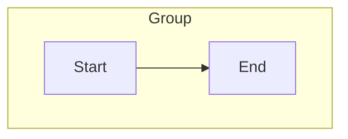
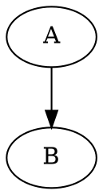

# Renderer smoke

> [!NOTE]
> A note with **strong text**.

> [!CAUTION]
> Be careful.

- [x] Task

Footnote here[^1]. :smile:

[^1]: Footnote text

$E=mc^2$

```javascript
const answer = 42
```



```chart
{"type":"bar","data":{"labels":["A"],"datasets":[{"label":"Value","data":[2]}]},"options":{"animation":false}}
```

[[toc]]

## Extra renderers

Term
: Definition text


```sequence-diagrams
Alice->Bob: Hello
```

```flowchart
st=>start: Start
e=>end: End
st->e
```


